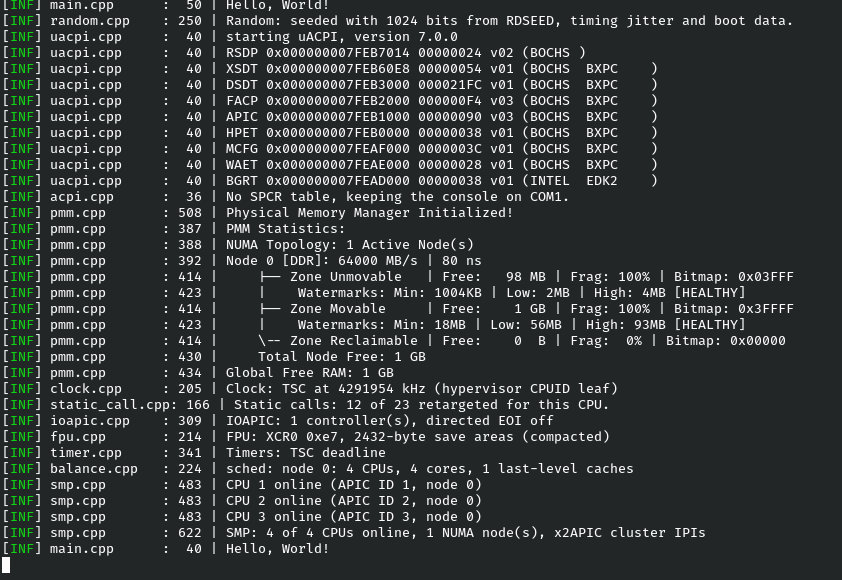

# Erebus

<div align="center">
<picture><source media="(prefers-color-scheme: dark)" srcset="https://www.shieldcn.dev/github/ci/My-Bad-2/Erebus.svg?variant=secondary&amp;mode=dark&amp;font=space-grotesk"></picture>
<picture><source media="(prefers-color-scheme: dark)" srcset="https://www.shieldcn.dev/github/release/My-Bad-2/Erebus.svg?variant=ghost&amp;mode=dark&amp;font=space-grotesk"></picture>
<picture><source media="(prefers-color-scheme: dark)" srcset="https://www.shieldcn.dev/github/license/My-Bad-2/Erebus.svg?variant=ghost&amp;mode=dark&amp;font=space-grotesk"></picture>
<picture><source media="(prefers-color-scheme: dark)" srcset="https://www.shieldcn.dev/github/last-commit/My-Bad-2/Erebus.svg?variant=secondary&amp;mode=dark&amp;font=space-grotesk"></picture>
<br />
<picture><source media="(prefers-color-scheme: dark)" srcset="https://shieldcn.dev/badge/C%2B%2B.svg?variant=ghost&amp;brand=cplusplus&amp;size=default&amp;mode=dark&amp;font=space-grotesk"></picture>
<picture><source media="(prefers-color-scheme: dark)" srcset="https://shieldcn.dev/badge/Compiled%20using-CMake-064F8C.svg?logo=cmake&amp;logoColor=fff&amp;variant=ghost&amp;size=default&amp;mode=dark&amp;font=space-grotesk"></picture>
<br />
<picture><source media="(prefers-color-scheme: dark)" srcset="https://shieldcn.dev/badge/Runs%20on-hopes%20%26%20dreams-FF69B4.svg?variant=ghost&amp;size=default&amp;mode=dark&amp;font=space-grotesk"></picture>
</div>

Erebus is a hobby kernel for x86-64 PCs, written in C++.

What was built (till now):

- A buddy allocator for physical memory, split per NUMA node and per mobility class, with
  per-CPU page caches in front of it. Blocks go from 4 KiB all the way up to 1 GiB.
- SLUB-style slab caches and a kernel heap on top of that. Very similar to Linux's SLUB.
- Address spaces built on VMAs: 4- or 5-level paging, PCID, memory filled in on the first
  fault, stacks that grow by themselves, and copy-on-write (🐄).
- Every CPU is online, on x2APIC or xAPIC, with an I/O APIC for device interrupts and cross-CPU calls (IPIs).
- A preemptive tickless scheduler: EEVDF for ordinary threads, FIFO for real-time ones, one run queue per CPU, and work
  stealing.
- Blocking Synchronization primitives: mutexes, semaphores, condition variables, completions and sleeps.
- Per-CPU timers with nanosecond deadlines, on the TSC-deadline timer or the APIC countdown,
  whichever the CPU has.
- Deferred calls for the slow half of an interrupt handler, which can't fail or overflow, and work queues for work that
  needs to sleep, with a pool of kernel threads on every NUMA node.
- Kernel daemons: Thread reaper (which preserves thread stacks for later on), and per-node reclaim and compaction
  threads that empty slab caches and per-CPU page caches when a node runs low.
- Processes with their own address spaces, user threads, and fork() with copy-on-write. Kernel threads borrow whatever
  page tables were loaded last instead of switching.
- A monotonic clock on the invariant TSC, measured against the HPET or the ACPI PM timer as fallback.
- A Basic Ring 3 Root Task.

## Building

Prerequisites:

- Clang and LLD (CI uses LLVM 23).
- CMake 3.28 or newer.
- xorriso.
- QEMU (`qemu-system-x86_64`) and Python 3.
- Doxygen and Graphviz (Optional).

```sh
git clone --recursive https://github.com/My-Bad-2/Erebus.git
cd Erebus
cmake --preset debug
cmake --build --preset debug
```

That leaves you with `build-debug/erebus.iso`, the kernel, and `build-debug/erebus-test.iso`,
the same kernel with its tests built in. The `release` preset does the same thing in `build/`,
with -O3 and ThinLTO.

If the LLVM you want isn't the one on your `PATH`:

```sh
cmake --preset debug -DLLVM_PREFIX=/usr/lib/llvm-23
```

## Running

```sh
cmake --build --preset debug --target qemu_run        # a QEMU window + terminal as serial console
cmake --build --preset debug --target qemu_headless   # no window.
cmake --build --preset debug --target qemu_debug      # For debugging (duh!)
```

For `qemu_debug`, attach with `gdb build-debug/kernel/kernel -ex 'target remote :1234'`. KASLR is on, by default, in
`misc/limine.conf`.

The guest gets 2 GiB of memory, 4 CPUs, `-cpu max` and KVM when the host has it. All of that can be modified as:

```sh
cmake --preset debug -DEREBUS_QEMU_SMP=16 -DEREBUS_QEMU_MEMORY=8G
```

Other parameters are `EREBUS_QEMU_CPU`, `EREBUS_QEMU_ACCEL` (`auto`, `kvm`, `hvf`, `whpx`, `tcg`) and
`EREBUS_QEMU_EXTRA_ARGS`.

<p align="center">
  
</p>

## Testing

The tests are built to run in the kernel environment itself. A second image, `kernel_test`, is linked from the same
objects as the real kernel plus everything under `tests/`. It boots in QEMU, runs every test and reports on the serial
console, and QEMU's exit status tells the final result: 1 if everything passed, 3 if something failed.

```sh
cmake --build --preset debug --target check    # one boot, console on screen
ctest --preset kernel                          # the same boot through CTest, after a build
cmake --workflow --preset check                # configure, build and test in one go
```

A run looks like this:

```text
ktest: running 665 tests on 4 CPUs
ktest: pass Maths.alignment (0 ms)
...
ktest: 658 passed, 0 failed, 7 skipped
ktest: ALL PASSED
```

Then there is the stress test, which boots the test kernel over: 1, 2, 4 and 8 CPUs, plus 8 CPUs laid out as two sockets
of two hyperthreaded cores, so the load balancer has more than one cache to think about. 512 MiB and 2 GiB, one NUMA
node or two, and CPU models with x2APIC, the TSC-deadline timer, PCID/INVPCID/FSGSBASE, the hardware RNG, compacted
XSAVE or XSAVE altogether taken away.

```sh
cmake --preset release
cmake --build --preset release --target qemu_stress
```

`cmake --workflow --preset stress` does both. The matrix lives in the `EREBUS_QEMU_STRESS_*`
cache variables (`-DEREBUS_QEMU_STRESS_JOBS=4` boots four at a time, if you have the cores),
and every boot leaves its serial log in `build/qemu_stress/`.

### Writing a test

Put a `.cpp` file anywhere under `tests/`:

```cpp
#include "utils/maths.hpp"

#include "ktest.hpp"

namespace maths = kernel::utils::maths;

KTEST(Maths, alignment) {
  KEXPECT_EQ(maths::align_up(0x1234, 0x1000), 0x2000);
  KEXPECT(maths::is_aligned(0x3000, 0x1000));
}
```

`KEXPECT_*` reports a failure and carries on, and `KREQUIRE_*` reports it and leaves the test. `KTEST_ALL_CPUS` runs the
body on every CPU at the same time, and `KTEST_SKIP` gives up politely when the machine can't run the test. The whole
framework is described in [tests/framework/ktest.hpp](tests/framework/ktest.hpp).

## Arch levels

By default, the kernel is built for `x86-64-v2`, which any x86-64 CPU since Intel Nehalem or AMD
Bulldozer should be able to run. If you know your target CPU, you can be pickier:

```sh
cmake --preset release -DEREBUS_ARCH_LEVEL=x86-64-v3   # or x86-64-v4, znver4, znver5
```

## Miscellaneous

Each of these wants its configure preset run once first: `cmake --preset release` before the
docs, `cmake --preset lint` before the lint build.

| Command                                              | What you get                                                                           |
|------------------------------------------------------|----------------------------------------------------------------------------------------|
| `cmake --build --preset docs`                        | Doxygen HTML in `build/docs/html/`, and the whole API as JSON in `build/docs/api.json` |
| `cmake --build --preset lint`                        | A Debug build in `build-lint/`, with clang-tidy going over the code                    |
| `cmake --build --preset debug --target format`       | Everything run through clang-format                                                    |
| `cmake --build --preset debug --target format_check` | The same check, without touching any file                                              |

And two options worth knowing: `-DEREBUS_UBSAN=ON` makes undefined behaviour trap, and
`-DEREBUS_WERROR=ON` turns every warning into an error. By default, only the warnings that are almost always bugs stop
the build.

## Project Structure

```text
kernel/        the kernel: boot, hal, memory, sched, proc, drivers, crypto, patch, utils
klib/          the freestanding C library and kformat
tests/         the in-kernel test framework, and the tests
cmake/         build modules, the QEMU test runner, Doxygen templates
third_party/   submodules, and the recipes for the Limine and OVMF downloads
misc/          limine.conf
```

## License

Erebus is released under the BSD 3-Clause License; see [LICENSE.md](LICENSE.md).
Copyright 2026 Yash Verma.

## Third-party code

None of this would be possible without other people's work. Thank you, all of you.

| Project                                                                                         | Contributors                                                                                                |
|-------------------------------------------------------------------------------------------------|-------------------------------------------------------------------------------------------------------------|
| [Limine](https://github.com/Limine-Bootloader/Limine)                                           | by Mintsuki and contributors                                                                                |
| [uACPI](https://github.com/uACPI/uACPI)                                                         | by Daniil Tatianin, and Contributors                                                                        |
| [Zydis](https://github.com/zyantific/zydis) and [Zycore](https://github.com/zyantific/zycore-c) | by Florian Bernd, Joel Höner, and contributors                                                              |
| [freestanding-cxx-hdrs-gnu](https://github.com/osdev0/freestanding-cxx-hdrs-gnu)                | by The GNU Compiler Collection (GCC) project team                                                           |
| [freestanding-lgrt](https://github.com/osdev0/freestanding-lgrt)                                | by The LLVM Project developer community (thanks to Mintsuki for separating out the freestanding components) |
| [edk2-ovmf](https://github.com/osdev0/edk2-ovmf-stable-bins)                                    | by the TianoCore community                                                                                  |

Each submodule carries its own license file under `third_party/`, and Limine's comes with the
download.
